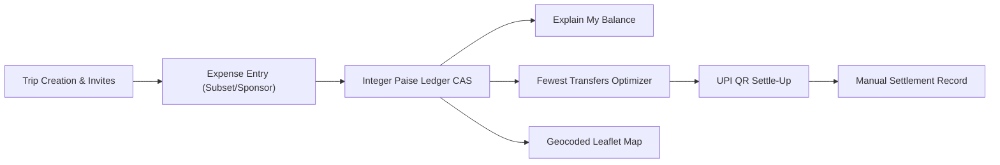
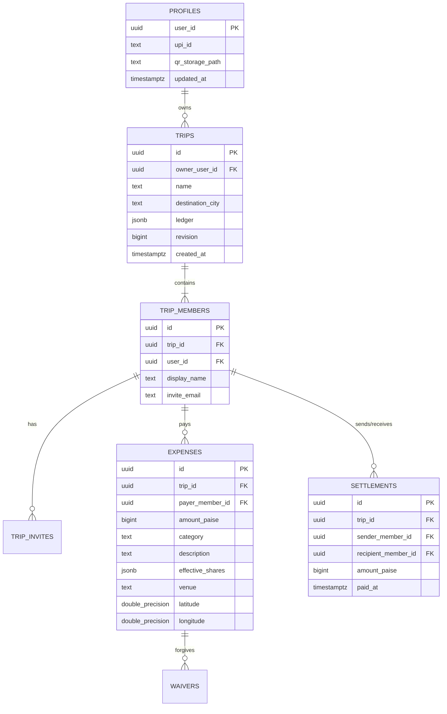

# TripTrack (TripSplit) — Comprehensive Project Report

## 1. Executive Summary

**TripTrack** (also referenced as **TripSplit**) is a collaborative group expense tracking and settlement web application engineered to solve the friction of group travel finances. When groups of friends or travel companions travel together, expenses are paid irregularly by different members, across varied categories (stays, transport, meals), and often split among varying subsets of participants.

TripTrack eliminates post-trip disputes through:
1. **Ten-second routine expense entry** with equal or subset splitting.
2. **Deterministic "Explain My Balance" transparency** that shows exactly how each member's balance is calculated.
3. **Fewest-Transfers Settlement Engine**: An exact zero-sum subset partition solver optimizing up to 8 nonzero balances via bitmask memoization.
4. **Shared Interactive Expense Map**: Geocoded venue mapping linking real-world locations with expense logs.
5. **Privacy-Preserving Debt Waivers & Sponsorship**: Debt forgiveness visible to the payer and group while discreetly shielding the recipient from stigma.
6. **Integrated External UPI Payments**: Uploaded private QR code rendering with offline settlement recording.



---

## 2. Technology Stack & Environment

| Layer | Technologies & Packages | Details |
|---|---|---|
| **Framework** | Next.js 16.4.6 (App Router), React 19.2.0 | High-performance server components and API route handlers |
| **Language** | TypeScript 5.9.0 | End-to-end static typing across models, routes, and UI |
| **Bundler** | Webpack 5 (CLI: `next dev --webpack`) | WASM/Webpack fallback configured for native Windows x64 stability |
| **Styling** | Tailwind CSS, Custom CSS Variables | Responsive design matching modern aesthetic design prototypes |
| **Database** | Supabase (PostgreSQL 15+) | Relational tables, JSONB ledger snapshots, and stored procedures |
| **Authentication** | Supabase Auth (`@supabase/ssr`) | Cookie-based session management and Google OAuth callback handling |
| **Object Storage**| Supabase Storage (`upi-qr` bucket) | Private bucket with signed short-lived URLs for UPI QR codes |
| **Mapping** | Leaflet with OpenStreetMap tiles | Attributed geocoded expense pins with branch resolution |
| **Testing** | Playwright (`@playwright/test`) | 11 automated integration and browser E2E test suites |
| **Persistence Mode** | Dual-Engine: Supabase & Local JSON | Transparent fallback to `.triptrack-data.json` for offline demoing |

---

## 3. Mathematical Foundations & Ledger Architecture

### 3.1 Integer Paise Accounting
To prevent floating-point rounding anomalies common in financial applications, all monetary values are computed and stored as **integer paise** (\$1 = 100\text{ paise}\). 

For an expense of amount $A$ split among $N$ participants:
$$\text{Base Share} = \left\lfloor \frac{A}{N} \right\rfloor$$
$$\text{Remainder Paise} = A - (\text{Base Share} \times N)$$

The remainder paise are distributed deterministically (1 paise each) in stable member sort order, guaranteeing exact conservation of funds:
$$\sum_{i=1}^N \text{Effective Share}_i = A$$

### 3.2 Balance Equation
For any member $m$, their net balance $B_m$ is governed by:
$$B_m = \text{Expenses Paid}_m - \text{Effective Shares}_m + \text{Settlements Sent}_m - \text{Settlements Received}_m + \text{Waivers Received}_m - \text{Waivers Granted}_m$$

The group-wide conservation invariant is strictly enforced:
$$\sum_{m \in \text{Members}} B_m = 0$$

### 3.3 Fewest-Transfers Optimization (Level 2 Settle-Up)
Rather than naive greedy settlement, TripTrack implements an exact **Zero-Sum Subset Partitioning** algorithm implemented in [lib/ledger.ts](file:///c:/Users/Udit%20Bhatt/OneDrive/Desktop/Splittrack/TripTrack-main/TripTrack-main/lib/ledger.ts#L100-L150) for up to 8 nonzero balances:
- The problem is mapped to finding the maximum number $k$ of disjoint subsets whose internal balances sum to 0.
- For a group with $n$ nonzero balances partitioned into $k$ independent zero-sum subsets, the minimum number of transactions required to clear the ledger is:
  $$\text{Min Transfers} = n - k$$
- For $n > 8$, the system falls back to a deterministic greedy heuristic to maintain low latency.

---

## 4. Database Architecture & Supabase Integration

The persistence schema is defined in [001_initial.sql](file:///c:/Users/Udit%20Bhatt/OneDrive/Desktop/Splittrack/TripTrack-main/TripTrack-main/supabase/001_initial.sql) and [002_shared_ledger.sql](file:///c:/Users/Udit%20Bhatt/OneDrive/Desktop/Splittrack/TripTrack-main/TripTrack-main/supabase/002_shared_ledger.sql).



### Compare-and-Swap Concurrency Control
Concurrent updates are protected via the PostgreSQL stored function `splittrack_save_trip(snapshot jsonb, expected_revision bigint)`. If two users submit edits simultaneously, the second write fails the revision comparison (`revision = expected_revision`) and leaves all relational tables untouched, preventing race conditions.

---

## 5. Key Feature Deep-Dive

### 5.1 Real-Time Expense Warnings
- **Duplicate Detection**: Flags bills within the same trip with matching normalized description/venue, exact amounts, and dates within $\pm 1$ day. Users can "Cancel" or "Save Anyway".
- **High-Spend Anomaly Detection**:
  - With $\ge 3$ category transactions: triggers if amount $\ge 3 \times \text{median}$ and $\ge \text{₹}1,000$ above median.
  - With $< 3$ transactions: triggers if amount $\ge \text{₹}5,000$.

### 5.2 Sponsorship & Discreet Debt Waivers
Implemented in [lib/trip-actions.ts](file:///c:/Users/Udit%20Bhatt/OneDrive/Desktop/Splittrack/TripTrack-main/TripTrack-main/lib/trip-actions.ts#L40-L90):
- **Sponsorship at Entry**: Payer covers another member's portion directly during creation.
- **Waiver after Entry**: The original payer forgives a specific share prior to trip settlement.
- **Discreet Privacy Guard**: On the server, the recipient's view is sanitized: their due amount decreases without displaying waiver tags or notification badges, while the payer and wider group see the audit log.

### 5.3 Automated Geocoded Leaflet Map
- In [app/dashboard/expense-map.tsx](file:///c:/Users/Udit%20Bhatt/OneDrive/Desktop/Splittrack/TripTrack-main/TripTrack-main/app/dashboard/expense-map.tsx), venue names and destination cities are resolved through a server-side geocoding proxy.
- Renders custom map markers with venue metadata, payer names, and amounts.
- Multi-branch selection disambiguates chain venues (e.g., cafes or hotels with multiple city locations).

### 5.4 UPI Payments & Verification
- Profile management allows users to store a UPI VPA and upload high-resolution QR codes (PNG/JPEG $\le 2\text{ MB}$).
- Served via short-lived signed URLs from private storage.
- Settle-up view isolates viewing from balance changes: users scan or copy in their external UPI app, then click "Record Payment" to persist a manual ledger entry.

---

## 6. Project File Structure

```text
TripTrack-main/
├── app/                               # Next.js App Router
│   ├── api/                           # Secure REST endpoints
│   │   ├── profile/route.ts           # UPI profile & QR management
│   │   └── trips/route.ts             # Trip & expense mutations
│   ├── auth/                          # Authentication module
│   │   ├── callback/route.ts          # OAuth code exchange
│   │   ├── sign-in/route.ts           # Google provider redirect
│   │   └── sign-out/route.ts          # Session termination
│   ├── dashboard/                     # Main TripTrack dashboard
│   │   ├── balances.tsx               # Balance sheet & Settle-up UI
│   │   ├── expense-map.tsx            # Leaflet interactive map
│   │   ├── expenses.tsx               # Expense lists & entry form
│   │   └── profile.tsx                # UPI ID & QR upload modal
│   ├── layout.tsx                     # Global layout & HTML shell
│   └── page.tsx                       # Landing page with demo trip loader
├── lib/                               # Core Business Logic & Algorithms
│   ├── demo.ts                        # 5 fictional repeatable demo trips
│   ├── ledger.ts                      # Balance calculator & subset partition solver
│   ├── supabase.ts                    # SSR & Service-Role client initializers
│   ├── trip-actions.ts                # Action handlers (waive, sponsor, settle)
│   ├── trip-store.ts                  # Dual storage layer (Supabase / JSON)
│   └── venues.ts                      # Geocoding & coordinate caching
├── prototypes/                        # UI/UX reference templates
│   ├── tripsplit_complete.html        # Complete production UI prototype
│   ├── tripsplit_living_landscape.html# Dynamic background prototype
│   └── prototypes/tripsplit_premium.html
├── supabase/                          # SQL migrations
│   ├── 001_initial.sql                # Base tables & RLS policies
│   └── 002_shared_ledger.sql          # CAS stored procedure & extensions
├── tests/                             # Comprehensive automated test suite
│   ├── run.mjs                        # Test runner harness
│   ├── shared-ledger.api.spec.ts      # Transactional concurrency tests
│   ├── trip.browser.spec.ts           # Playwright E2E browser flows
│   └── trips.api.spec.ts              # Financial accounting API specs
└── package.json                       # Next.js 16, React 19, Supabase dependencies
```

---

## 7. Verification & Test Suite Execution

The automated test suite runs via Playwright and Node test runner, testing both backend logic and frontend interactions.

### Test Results Summary (All 11 Passed)
```text
Running 11 tests using 1 worker

  ✓ 1 [integration] a shared invitation is email-bound, expires, and only grants one membership (36ms)
  ✓ 2 [integration] only the signed-in payer can waive a share (9ms)
  ✓ 3 [integration] PostgreSQL saves shared records and serializes conflicting ledger updates (1.9s)
  ✓ 4 [integration] judging ledger, warning cancellation, repayment and retry (1.8s)
  ✓ 5 [integration] five demo trips have repeatable expense counts (214ms)
  ✓ 6 [integration] signed-out users cannot access UPI profiles (699ms)
  ✓ 7 [integration] sponsorship, venue branches, edits, retries, and waivers persist (537ms)
  ✓ 8 [e2e] create a trip, split a bill, inspect balances, and record repayment (8.0s)
  ✓ 9 [e2e] mobile landing page reaches the dashboard (1.6s)
  ✓ 10 [e2e] living landscape can pause and the demo recalculates settlement (1.9s)
  ✓ 11 [e2e] add a member email, see the map, and open sign-in (3.0s)

  11 passed (39.0s)
```

---

## 8. Current Deployment & Runtime Status

> [!NOTE]
> The application is currently running locally and actively synced with GitHub.

- **Local Development Server**: [http://localhost:3000](http://localhost:3000) (Next.js 16.4.6 with Webpack bundler, HTTP 200 OK)
- **Database Connection**: Configured with live Supabase project credentials in [.env.local](file:///c:/Users/Udit%20Bhatt/OneDrive/Desktop/Splittrack/TripTrack-main/TripTrack-main/.env.local) (`vbzovrtqrvvqdniwfwtg.supabase.co`)
- **Remote Version Control**: Pushed and synced to [`github.com/uditbhatt55/TripTrack`](https://github.com/uditbhatt55/TripTrack) on branch `main`
- **Demo Mode**: Instant pre-loading of 5 fictional trips (Coral Bay, Himalayan Pass, Western Ghats, Golden Triangle, Coastal Kerala) with 20–36 expenses each.
